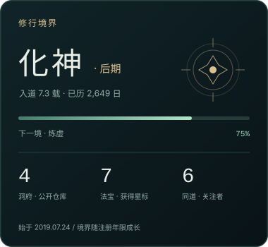
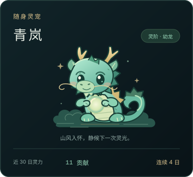
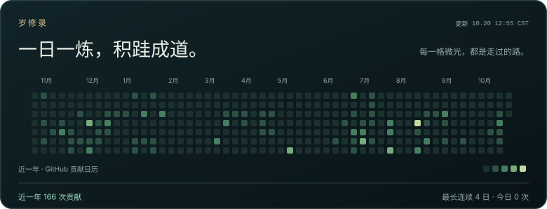
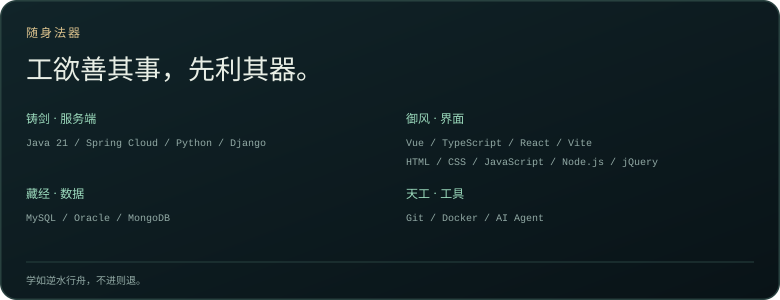
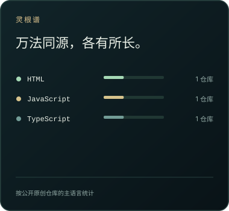

<!--
Lehman's cultivation-themed GitHub profile, card layout, and maintenance guide.

@author Lehman+AI
@site https://www.lehman.top
@since 2026/10/10 17:33
-->

  <picture>
    <source media="(max-width: 600px)" srcset="assets/profile/hero-mobile.svg">
    
  </picture>

  
  &nbsp;
  

  <picture>
    <source media="(max-width: 600px)" srcset="assets/profile/activity-mobile.svg">
    
  </picture>

  <picture>
    <source media="(max-width: 600px)" srcset="assets/profile/formations-mobile.svg">
    
  </picture> 
  <a href="https://www.lehman.top/">
    <picture>
      <source media="(max-width: 600px)" srcset="assets/profile/link-1-mobile.svg">
      
    </picture>
  </a> 
  <a href="https://blog.lehman.top/">
    <picture>
      <source media="(max-width: 600px)" srcset="assets/profile/link-2-mobile.svg">
      
    </picture>
  </a> 
  <a href="https://www.windseeker.link/">
    <picture>
      <source media="(max-width: 600px)" srcset="assets/profile/link-3-mobile.svg">
      
    </picture>
  </a> 
  <a href="https://disk.windseeker.link/">
    <picture>
      <source media="(max-width: 600px)" srcset="assets/profile/link-4-mobile.svg">
      
    </picture>
  </a> 
  <a href="https://fairy-tales.windseeker.link/">
    <picture>
      <source media="(max-width: 600px)" srcset="assets/profile/link-5-mobile.svg">
      
    </picture>
  </a> 
  <a href="https://github.com/Lehman1024">
    <picture>
      <source media="(max-width: 600px)" srcset="assets/profile/link-6-mobile.svg">
      
    </picture>
  </a>

 

  <picture>
    <source media="(max-width: 600px)" srcset="assets/profile/arsenal-mobile.svg">
    
  </picture>

  
  &nbsp;
  

<h2 align="center">山海有期，逐风不止。</h2>

  
修行法则 · 数据如何计算

  
境界按 GitHub 注册年限计算：0 年练气、1 年筑基、2 年金丹、3 年元婴、5 年化神、8 年炼虚、12 年合体、16 年大乘、20 年渡劫、25 年飞升。

  
灵宠始终名为「青岚」，成长阶段按近一年贡献总数计算：0 龙蛋、50 幼龙、200 青龙、800 应龙、2000 神龙。贡献采用 GitHub 的贡献统计口径，包括符合条件的提交、议题、拉取请求等，不等同于提交次数。

  
修行日历在桌面展示近一年，在手机展示最近 16 周。语言分布按公开非 Fork 仓库的主要语言计数；获得的 Star 也仅汇总公开非 Fork 仓库。

  
每天北京时间 08:17 定时更新，实际执行可能延迟。岁修录标注数据更新时间；账户资料抓取失败时停止更新，贡献日历无法获取时显示缺失，不编造数值。连续天数在今日尚未贡献时允许从昨天起算，日期采用 GitHub 贡献日历口径。

  
洞府维护 · 本地生成与预览

  
使用 Node.js 22，在仓库根目录运行以下命令。联网更新可设置环境变量 <code>GITHUB_TOKEN</code>，GitHub Actions 会自动提供。

  <pre><code>node scripts/generate-profile.mjs
node scripts/generate-profile.mjs --cached
node scripts/preview.mjs
node --test scripts/github-data.test.mjs</code></pre>
  
第一条抓取数据并生成卡片，第二条使用本地缓存重新生成，第三条启动预览，第四条验证贡献数据解析与异常处理。预览地址：<a href="http://127.0.0.1:8787/">http://127.0.0.1:8787/</a>；浅色背景：<a href="http://127.0.0.1:8787/?theme=light">?theme=light</a>。

